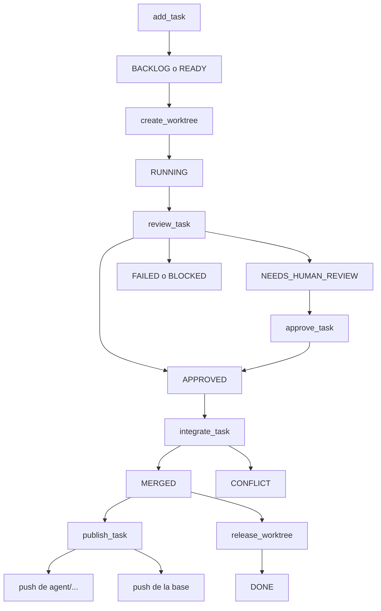

# Arquitectura del orquestador

## Overview

El paquete `orchestrator/` (versión `0.1.0`) reparte un trabajo ya definido en tareas de Git, aísla cada una en su worktree y deja que un solo proceso fusione y publique. El punto de entrada es `python3 -m orchestrator`, que llega a `cli.main` desde `orchestrator/__main__.py`. El CLI no arranca modelos ni runtimes de agente.

`product_guard` exige en la raíz el archivo `MASTER_PROMPT_FINANCIAL_OPERATIONS.md` (`MASTER_NAME`). Ese archivo no está. `docs/documento-maestro.md` sí está, y el mensaje del guardia dice que ese documento no sustituye ese nombre. Sin el master, `product-guard` lanza `OrchestratorError` con código `blocked` y no autoriza cambios de producto. Este informe no inventa el contenido del master ni define un producto financiero. `ORCHESTRATOR.md` remite al mismo archivo y pide detener el producto si no se puede leer.

## Key Concepts

- **Tarea.** Registro en `.orchestrator/state.json`, creado por `add_task`. Campos que sigue el flujo: `id`, `status`, `owns`, `risk`, `base`, `depends_on`, `validate_cmd`, `branch`, `worktree`, `checks`, `sensitive_diff`, `human_approved`, `sha`.
- **Integrador.** Proceso en el que `ORCH_ROLE` no es exactamente `child`. `require_integrator` lo deja pasar.
- **Hijo.** Proceso con `ORCH_ROLE=child`. `render_prompt` escribe esa variable en el texto del prompt. El CLI no exporta la variable ni lanza al agente.
- **Ownership.** Lista `owns` de rutas. `overlaps` declara choque cuando un path es prefijo del otro. Una lista vacía ocupa el repositorio entero: `ownership_conflict` devuelve la otra tarea `RUNNING` en cuanto una de las dos listas está vacía.
- **Diff sensible.** `review_task` pone `sensitive_diff` si `risk` está en `SENSITIVE_RISKS` (`alto`, `critico`) o si algún path del diff, partido por `path_is_sensitive`, contiene un token de `SENSITIVE_TOKENS` (autorización, pagos, banco, ledger, tenant, secretos, seguridad, en español e inglés).

## How It Works

### De la tarea al worktree

`task-add` llama a `add_task`. El id tiene que cumplir `ID_RE`: empieza por letra o dígito y mide como mucho 41 caracteres (`[A-Za-z0-9._-]`). El riesgo es `bajo`, `medio`, `alto` o `critico`. `branch_exists` exige que la rama `base` exista; el default del CLI es `main`. Cada entrada de `depends_on` tiene que estar ya en el estado. `_cycle` rechaza un ciclo, incluido el caso en que la tarea depende de sí misma. La tarea nace en `BACKLOG`. `refresh_ready` la pasa a `READY` cuando cada dependencia está en `TERMINAL_DEPS`, es decir `MERGED` o `DONE`.

`worktree <id>` y `allocate` terminan en `create_worktree`:

1. `worktrees_ignored` exige que `git check-ignore` ignore `.worktrees/x`. El comentario del código explica por qué no basta con probar `.worktrees`: el patrón `.worktrees/` no coincide hasta que el directorio existe. Si `.gitignore` no cubre ese path, la creación sale `blocked`.
2. Con `state.lock` tomado, la tarea tiene que existir y estar `READY`.
3. `ownership_conflict` mira solo tareas `RUNNING`. Si hay choque, guarda `block_reason` (`ownership en conflicto con <id>`) y lanza `blocked`. El estado sigue `READY`. `allocate` se traga ese `blocked` y prueba la tarea siguiente. `worktree` directo propaga el error.
4. La rama es `agent/{id}-{slug}`. `slug` baja el título a minúsculas, sustituye lo que no sea `[a-z0-9]` por guiones y corta a 40 caracteres. Si la rama o el directorio `.worktrees/<id>` ya existen, aborta.
5. Crea el padre si falta y ejecuta `git worktree add -b <rama> <repo>/.worktrees/<id> <base>`.
6. Guarda `branch` y `worktree`, pasa la tarea a `RUNNING`, limpia `block_reason` y anexa un evento `worktree` en `.orchestrator/log.jsonl`.

`DEFAULT_MAX_SLOTS` es `None`. `allocate` crea un worktree por cada `READY` que no choque. `--max-slots N` se detiene al llegar a N. El código no fija un máximo de tres.

`render_prompt` describe el aislamiento: rama, worktree, rutas de `owns`, y la prohibición de commit o push a la rama principal, de merge, de force-push, de `reset --hard` y de un clean destructivo. Es el texto que recibe el agente. El sistema de archivos no recorta `owns`.

### Revisión

`review` llama a `review_task`. Exige `RUNNING` y un worktree limpio (`porcelain`). Con `validate_cmd`, `_run_validate` lo ejecuta con `shell=True` dentro del worktree y guarda `PASS` o `FAIL` más los últimos 500 caracteres de salida. Sin comando, el check queda `BLOCKED` con evidencia `no hay comando`.

Si algún check no es `PASS`, el estado pasa a `FAILED`, o a `BLOCKED` cuando el resultado fue `BLOCKED`. Si todos pasan y el diff es sensible, el estado es `NEEDS_HUMAN_REVIEW`. En caso contrario es `APPROVED`.

`approve` solo corre si `require_integrator` pasa, el estado es `NEEDS_HUMAN_REVIEW`, los checks están en `PASS` y `--approver` no está vacío. El CLI toma `ORCH_APPROVER` o, si falta, la cadena `humano-local`. Anota `approver` y `approved_at` y deja la tarea en `APPROVED`. No fusiona.

### Integración

El subcomando `integrate` llama a `integrate_task` y, si vuelve, a `publish_task`.

`integrate_task` exige integrador y toma `integrate.lock`. `_lock` usa `fcntl.flock` en exclusiva y sin espera (`LOCK_EX | LOCK_NB`). Si otro proceso tiene el lock, la respuesta es `busy` y la rama base no se toca. Dentro del lock:

- `porcelain` del repositorio integrador está vacío.
- El estado es `APPROVED`. `NEEDS_HUMAN_REVIEW` sale con código `needs_human`. Un `sensitive_diff` sin `human_approved` también. El CLI traduce `needs_human` a salida 2, y `blocked`, `conflict` o `busy` a salida 3.
- `current_branch` del repositorio es `task["base"]`.
- El worktree de la tarea está limpio.
- `git merge --no-ff --no-edit` de `task["branch"]`, con mensaje `Integra <id>: <título>`.

Si el merge falla, corre `git merge --abort`, guarda `CONFLICT` y `block_reason`, y el SHA de la base se queda en el valor anterior. Si el abort deja el árbol sucio, el error pasa a `failed` (`el merge quedo sucio tras abortar`), con `CONFLICT` ya escrito. Si el merge sale bien, el estado es `MERGED`, `sha` es el HEAD nuevo, `merged_from` es el HEAD previo, y `refresh_ready` suelta a las dependientes.

`release` exige integrador y estado `MERGED`. Si `.worktrees/<id>` existe y está sucio, se niega. Si existe y está limpio, `git worktree remove`. El estado pasa a `DONE`. Una dependiente ya pudo quedar `READY` en el `MERGED`; no espera al `DONE`.

### Quién puede pushear

Por el CLI, pushea el integrador: el proceso en el que `child_role()` es falso. `push_ref` llama a `require_integrator` antes de `git push`. Con `ORCH_ROLE=child` fallan `push`, `push-base` y `publish_task`, y también `approve`, `integrate` y `release`. El paquete no consulta usuarios de GitHub. El aprobador es el texto de `--approver`.

Tres caminos:

- `push <id>` llama a `push_task`. Sube `task["branch"]` con `allow_base=False`. Si esa ref fuera `main` o `master`, `push_ref` la rechaza (`un push de agente no actualiza la rama principal`). La función sube la rama aunque la tarea no esté `APPROVED`.
- `push-base <id>` llama a `push_base`. Exige estado `MERGED` o `DONE`. Sube `task["base"]` con `allow_base=True`, así que `main` o `master` pueden salir por aquí.
- `integrate` no acepta `--remote`. Tras el merge, `publish_task` lee `git remote get-url origin`. Sin URL, sale `blocked` (`no hay remoto origin; el cambio queda sin publicar`) y el merge local ya está hecho. Con URL, sube primero la rama del agente y después la base, y anota el evento `publish`.

`forbid`, dentro de `run_git`, rechaza un `push` que lleve `--force`, `--force-with-lease` o `-f`, un `reset --hard` y un `clean` cuya bandera combine `f` y `d`. Eso cubre solo los Git que lanza el orquestador.

El hook `orchestrator/hooks/pre-push` cubre el `git push` que no pasa por el CLI. `install_hooks` lo copia a `hooks/pre-push` del directorio común de Git (`git rev-parse --git-common-dir`) y lo deja ejecutable. En un worktree enlazado (`git-dir` distinto de `git-common-dir`) el hook rechaza actualizar `refs/heads/main` y `refs/heads/master`. También rechaza borrar una ref (SHA local todo ceros) y un push cuyo SHA remoto no es ancestro del local. Desde el worktree del agente el hook deja subir la rama `agent/...`. En el checkout principal, `git-dir` y `git-common-dir` coinciden, así que el hook no trata ese push de `main` como push de un worktree de agente. Sin `install-hooks`, un `git push` directo no pasa por `forbid`.

## Where Things Live

- `orchestrator/engine.py`: estado, locks, worktrees, revisión, merge, push, `product_guard`, `render_prompt`, `doctor`.
- `orchestrator/cli.py`: subcomandos. `integrate` fusiona y después publica.
- `orchestrator/__init__.py`: versión `0.1.0`. El módulo se describe como worktrees, DAG y un solo integrador.
- `orchestrator/__main__.py`: entrada de `python3 -m orchestrator`.
- `orchestrator/hooks/pre-push`: fuente del hook.
- `orchestrator/inventory.py`: `scan_binaries` y `scan_skills`. No participa en el merge. El comando es `inventory`.
- `.orchestrator/state.json`, `log.jsonl`, `state.lock`, `integrate.lock`: estado local. La primera línea de `.gitignore` excluye `.orchestrator/`. `save_state` escribe un temporal y lo sustituye con `replace`.
- `.worktrees/<id>/`: checkout de la tarea. `.gitignore` también excluye `.worktrees/`.
- `tests/test_orchestrator.py`: worktrees separados, ownership solapado, merge de riesgo bajo, revisión humana, conflicto con abort, árbol sucio, lock, hook, publish y `product_guard`.
- Contrato escrito: `ORCHESTRATOR.md`, `docs/orchestrator/02-plan-y-lanzamiento.md` (fase 6) y `docs/orchestrator/04-integracion.md`. Cuando ese contrato y el código discrepan, manda `engine.py`.

## Gotchas

- `MASTER_PROMPT_FINANCIAL_OPERATIONS.md` no está en este worktree. `product_guard` sale `blocked` y cita `docs/documento-maestro.md` solo para decir que no reemplaza ese nombre. `create_worktree` e `integrate_task` no llaman al guardia. La ausencia bloquea el producto cuando alguien corre `product-guard`. Crear un worktree de orquestación sigue disponible.
- `ORCH_ROLE` no autentica. Cualquier otro valor, o la variable ausente, cuenta como integrador. El prompt pide al hijo que exporte `child`; el proceso tiene que hacerlo él.
- `require_integrator` corta todo `push_ref`, la rama de trabajo incluida. Un hijo que ignore el CLI y ejecute `git push` en su worktree puede publicar `agent/...` con el hook instalado. El hook le corta `main` y `master`.
- `owns` es una convención del estado. Un shell con el mismo usuario Unix puede escribir en el árbol principal. El hook no vigila escrituras, solo `git push`.
- `docs/orchestrator/03-supervision-y-calidad.md` nombra los estados `REVIEW` y `CANCELLED`. `engine.py` no los asigna. `review_task` sale de `RUNNING` hacia `APPROVED`, `NEEDS_HUMAN_REVIEW`, `FAILED` o `BLOCKED`.
- La fase 6 admite el ejemplo `feat/<task-id>-<short-description>`. `create_worktree` solo crea `agent/<id>-<slug>`.
- Sin `validate_cmd`, la revisión queda `BLOCKED`. No hay un `PASS` implícito.
- `integrate.lock` cubre el merge. `publish_task` corre después, con el lock ya suelto. Otro `integrate` puede fusionar una segunda tarea antes de que el primero termine el push.
- Si `origin` no tiene URL, la tarea puede quedar `MERGED` en local y `publish_task` salir `blocked`.
- `state.lock` e `integrate.lock` comparten el texto `integracion ocupada`. Un `task-add` que choca con un merge ocupado recibe el mismo `busy`.
- `push_task` no exige `APPROVED`. El integrador puede publicar la rama de trabajo antes de la revisión.
- `forbid` no envuelve un `git` escrito en la shell. El force-push directo lo rechaza el hook, y solo después de `install-hooks`.
